# Formula Student Korea Timekeeper

Wireless timing system for Formula Student Korea dynamic events.

## Features

* Wireless timing with one USB master and up to five sensors
   * Wireless range over 200 m and time synchronization error below 3 µs
* Optional line-scan [photo finish camera](photofinish) with car number recognition
* [Web console](https://luftaquila.github.io/fsk-timekeeper/) with a standalone HTML file for offline use

<details>
<summary>Wireless time sync test result</summary>

https://github.com/user-attachments/assets/1cac1805-847e-4b83-8514-46a629c6ced4

* CH1 (Yellow): Master
* CH2 (Cyan) : Sensor

| Statistic | Offset |
| --- | ---: |
| Mean | +0.06 µs |
| Sample standard deviation | 0.54 µs |
| Minimum | −0.89 µs |
| Maximum | +1.14 µs |

</details>

## Usage

### 1. Prepare

1. Open the [web console](https://luftaquila.github.io/fsk-timekeeper/) in a browser with Web Serial support.
   * For offline use, download `fsk-timekeeper-console.html` from the [latest release](https://github.com/luftaquila/fsk-timekeeper/releases/latest).
2. Connect the master over USB and click `Connect` in `Settings`.
3. Power the sensors.
4. Under `Settings` → `Sensors`, assign each sensor to `Start`, `Finish`, or `Unused`.
    * Lap timing uses only the `Start` sensor.

### 2. Measure

1. Select `Start → Finish` or `Laps` in `Timing`.
2. Click `Start` to arm the timer. Timing starts on the first pass by the start sensor.
3. Complete the run:
   * `Start → Finish`: pass the finish sensor to end the run.
   * `Laps`: each subsequent pass by the start sensor records a lap.

| Start → Finish | Laps |
| :---: | :---: |
| 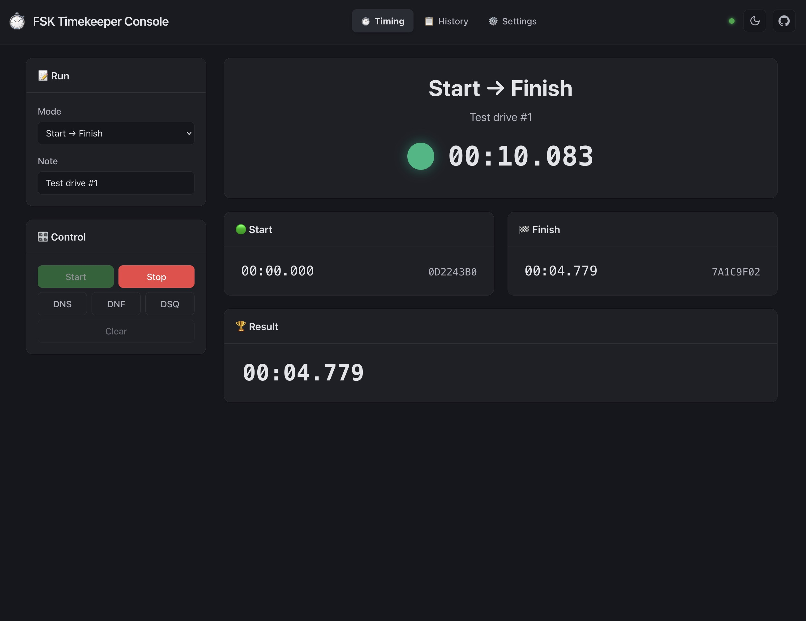 | 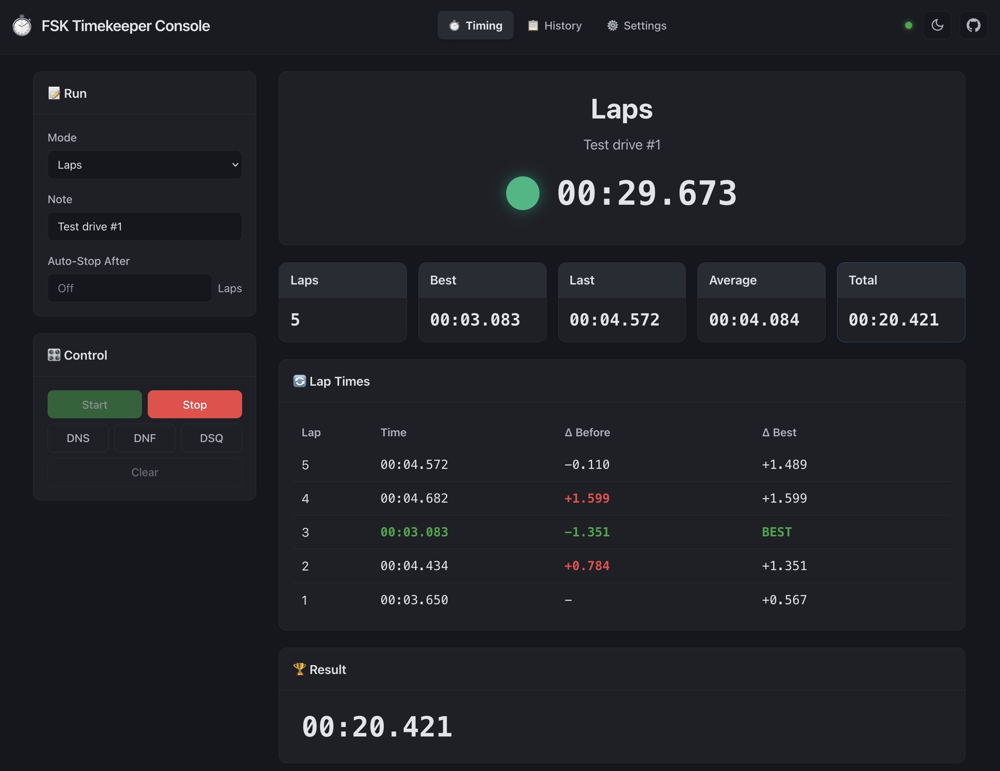 |

### 3. View and save results

Results are saved in the browser and listed in `History`.

* `Export Excel`: export results for the selected mode.
* `Backup` → `Download`: back up results from all modes and device logs as JSON.
* `Backup` → `Restore`: import a JSON backup.

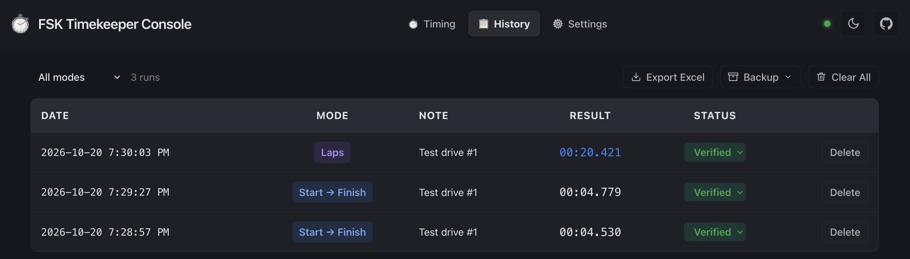

> [!IMPORTANT]
> If a storage error appears, download a backup before closing the page.\
> Adding the site to your bookmarks may resolve the error.
>
> 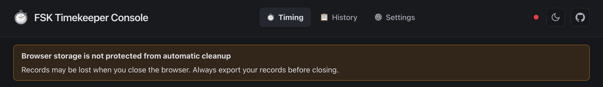

## Do It Yourself!

### 1. Build the PCB

1. Download `fsk-timekeeper-pcb.zip` from the [latest release](https://github.com/luftaquila/fsk-timekeeper/releases/latest) and extract it.
2. Place a JLCPCB PCBA order for five boards (the minimum quantity) using the included GERBER, BOM, and CPL files.

### 2. Solder the parts

<details>
<summary>Bill of materials</summary>

| Qty | Part | Image |
| ---: | --- | :---: |
| 5x | Assembled `fsk-timekeeper` PCB | |
| 5x | 22 µH SMD power inductor, 0630 package | 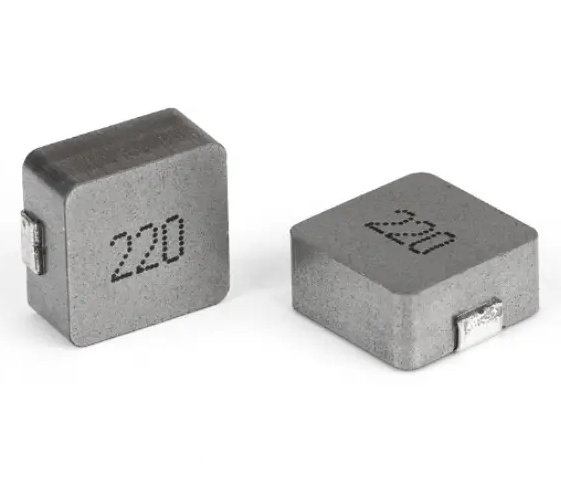 |
| 5x | `SuperMini nRF52840` development board | 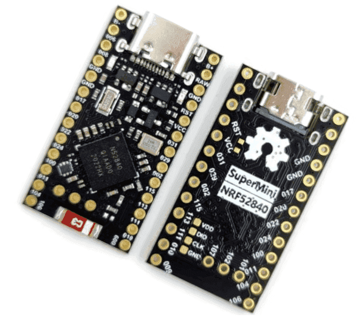 |
| 5x | `Ra-01SH` LoRa module | 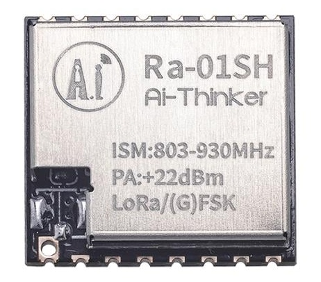 |
| 5x | LoRa antenna with IPEX-to-SMA female cable | 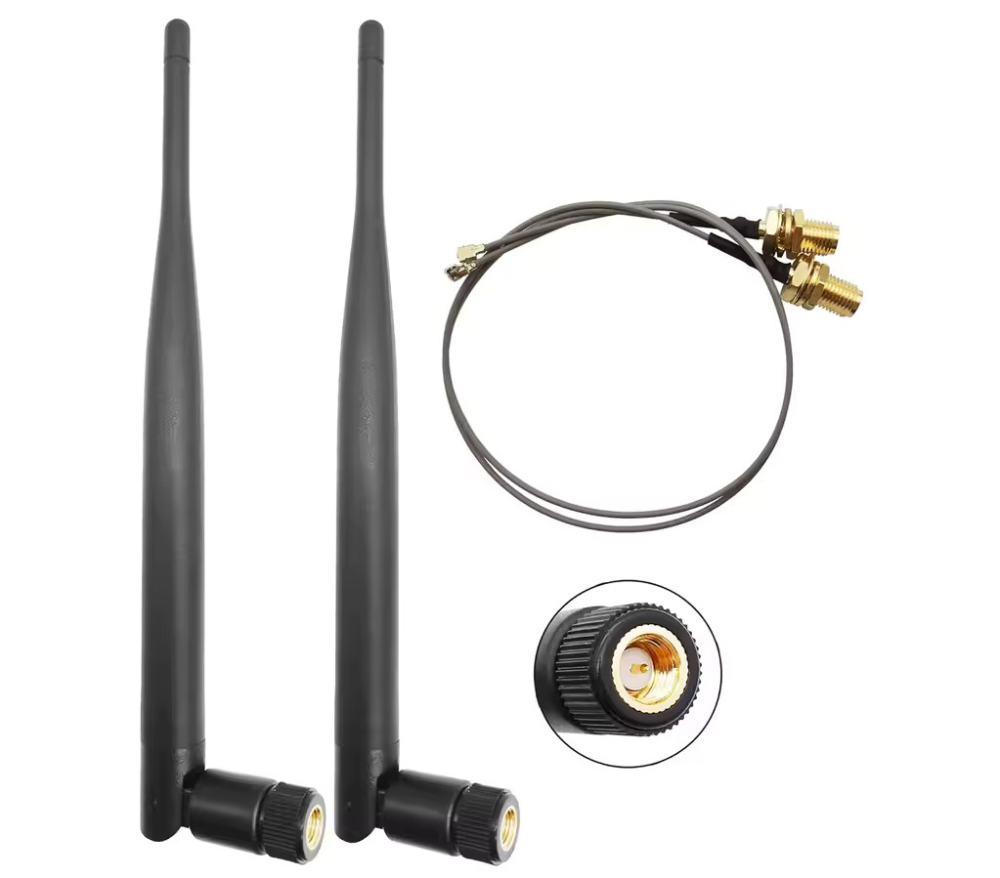 |
| 4x | Single-cell SMD 18650 battery holder and 18650 battery | 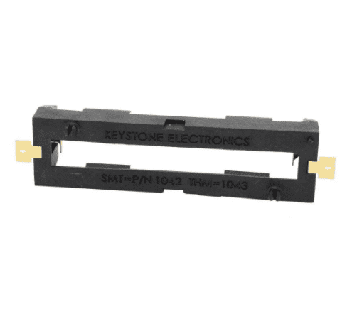 |
| 4x | `MTS-102` mini toggle switch | 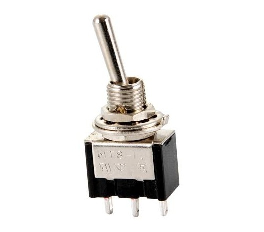 |
| 4x | [Autonics BA2M-DDT](https://www.autonics.com/kr/model/BA2M-DDT) diffuse reflective photoelectric sensor | 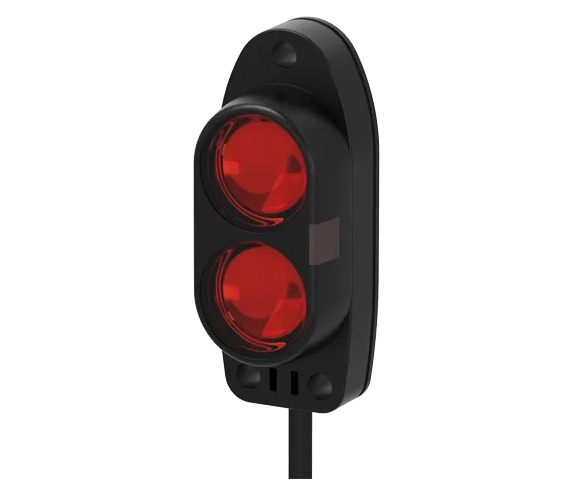 |
| 4x | [Molex 5569-04A2 (39300040)](https://www.molex.com/en-us/products/part-detail/39300040) board connector | 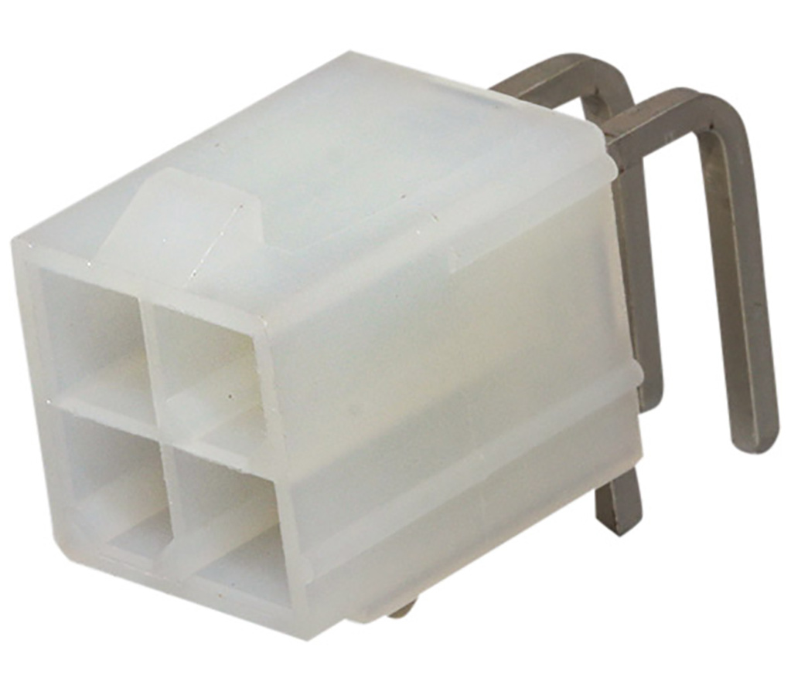 |
| 4x | [Molex 5557-04R (39012040)](https://www.molex.com/en-us/products/part-detail/39012040) cable housing | 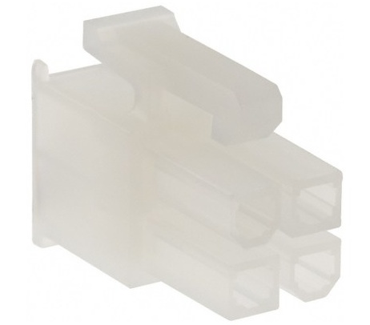 |
| 12x | [Molex 5556T (39000038)](https://www.molex.com/en-us/products/part-detail/39000038) crimp terminal | 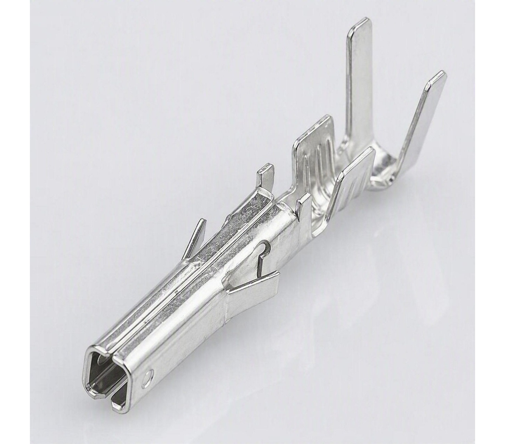 |
| 1x | `ATGM336H` GPS module with antenna | 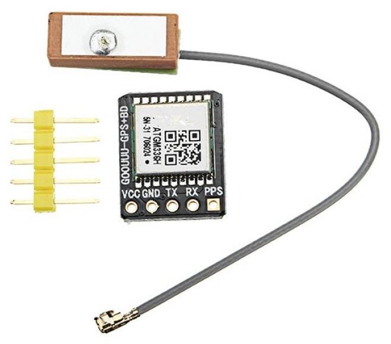 |

</details>

> [!NOTE]
> The JLCPCB PCBA order above costs about <span>$</span>7, excluding shipping.\
> The full set of parts costs about <span>$</span>40 on AliExpress, excluding BA2M-DDT sensors and 18650 batteries.

> [!IMPORTANT]
> Solder `U2` first. Installing `U1` first makes `U2` harder to solder.

1. All boards: solder `U2` (Ra-01SH), `U1` (SuperMini nRF52840), and `L1` (22 µH 0630 inductor).
2. Master: solder the GPS module at `U4` and connect its antenna.
3. Sensors: solder the battery holder at `BT1` and the `5569-04A2` connector at `J1`, then wire the toggle switch to `SW1`.
4. Connect each LoRa module to an IPEX-to-SMA cable.

| 3D view | Layout |
| :---: | :---: |
| 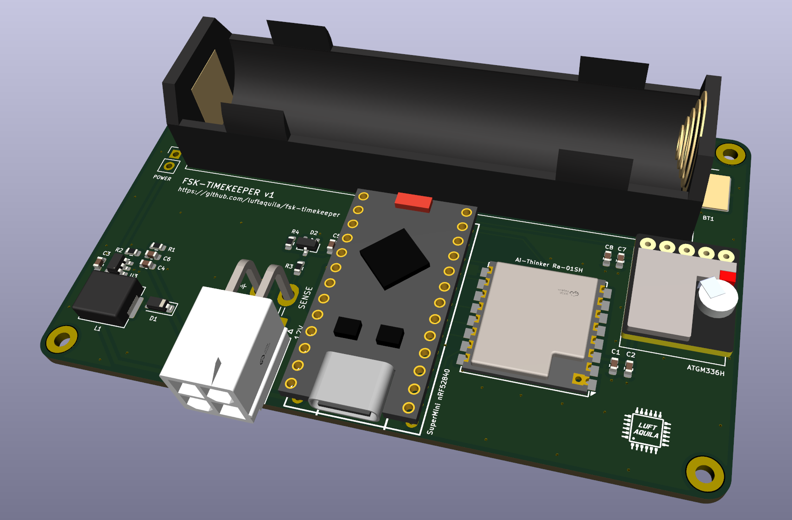 | 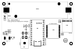 |

### 3. Housing assembly

Required per sensor: 4x M2 × 8 mm and 3x M3 × 14 mm hex bolts.

1. Download `fsk-timekeeper-3d.zip` from the [latest release](https://github.com/luftaquila/fsk-timekeeper/releases/latest) and extract it.
2. 3D-print 1x `master.stl`, 4x `sensor.stl`, and 4x `sensor-holder.stl`.
3. Mount the SMA connectors and attach the LoRa antennas.
4. Mount the switches and insert 18650 batteries into the sensor housings.
5. Secure each PCB between the base and lid with M2 bolts.
6. Secure the `BA2M-DDT` sensor to the holder with M3 bolts, then mount the holder on a tripod.

### 4. Upload firmware and configure devices

1. In console's `Firmware Upgrade`, select `fsk-timekeeper-firmware.zip` and click `Upgrade`.
2. Select the port and keep the USB cable connected until the upload is complete.
   * If a new board does not enter bootloader mode automatically, short the `RST` pin to `GND` twice quickly.
3. Click `Reconnect` and select the board to verify the new firmware version.
4. Generate a new key under `Radio Key` and apply it to the first board.
5. Set up the remaining boards with the same firmware and radio key.

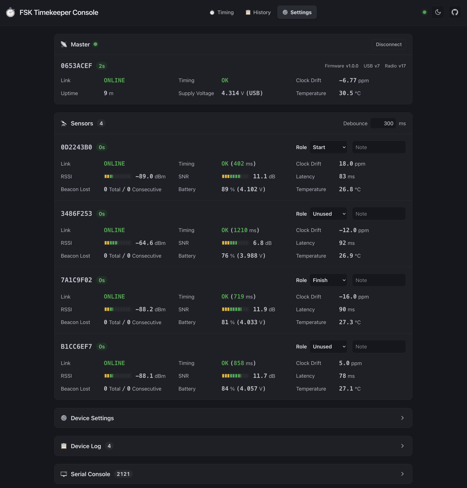

> [!IMPORTANT]
> The master and all sensors must use the same firmware version, radio settings, and key.

> [!TIP]
> The board connected over USB acts as the master. Battery-powered boards act as sensors.

### 5. Connect the sensors

| Pinout | Wiring |
| :---: | :---: |
| 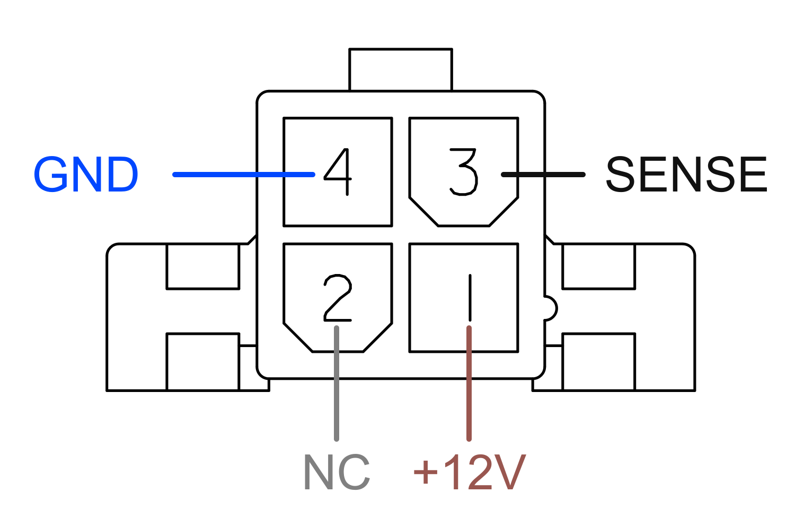 | 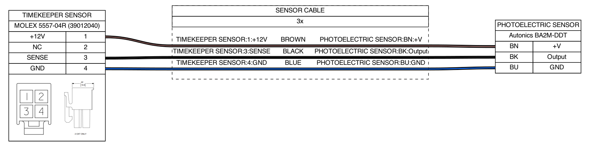 |

## Development

<details>
<summary>Click to expand</summary>

### Firmware

* Requires: Arm GNU Toolchain (`arm-none-eabi-gcc`, newlib-nano), Make, Python 3

  ```sh
  make -C device/firmware test
  make -C device/firmware
  ```

### Web console

* Requires: Node.js 22

  ```sh
  cd console
  npm ci
  npm test
  npm run dev           # development server
  npm run build:single  # standalone HTML at dist-single/index.html
  ```

### PCB

* Requires: KiCad 10+
* Open [fsk-timekeeper.kicad_pro](device/hardware/fsk-timekeeper.kicad_pro)

### Housing 3D model

* Requires: OpenSCAD Nightly

  ```sh
  make -C device/3d
  ```

</details>

## LICENSE

For non-commercial use only:

```
"THE BEERWARE LICENSE" (Revision 42):
LUFT-AQUILA wrote this project. As long as you retain this notice,
you can do whatever you want with this stuff. If we meet someday,
and you think this stuff is worth it, you can buy me a beer in return.
```

이 저장소의 모든 내용은 비상업적 용도로 자유롭게 사용할 수 있습니다.\
이 프로젝트가 마음에 든다면, 언젠가 우리가 만나게 되었을 때 맥주 한 잔 사 주세요.
